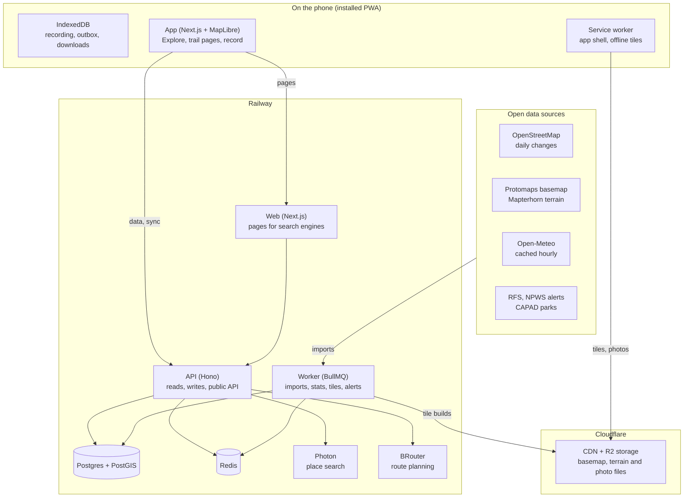
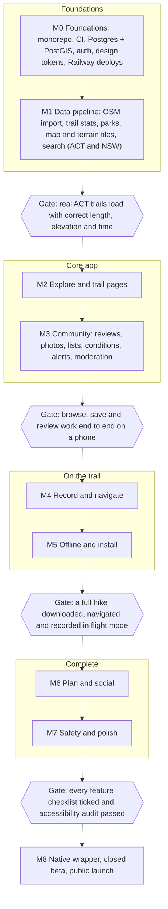

# Trailaroo PWA — Product & Build Spec

Last updated: 25 Nov 2026 · Owner: Mohammad Syed

## Summary

We're building a free, open, installable web app for finding, planning, recording and sharing trails. It does everything AllTrails does, with nothing behind a paywall, and it runs on open data that the community can improve. It ships as a PWA, so it works in any phone or desktop browser, installs to the home screen and works offline on the trail.

**Name:** Trailaroo (trailaroo.com). Chosen 25 Nov 2026; see Risks and open questions > Decisions made.

**Who it's for**

- Hikers, walkers, runners and riders who want trail info, maps and navigation without a subscription.
- Locals who know their trails and want to keep the info accurate: conditions, closures, photos, reviews.
- Clubs, councils and park groups who want to publish and maintain routes in the open.

**Principles**

1. **Everything free, from day one.** Offline maps, navigation, wrong-turn alerts, conditions, weather, heatmaps, custom routes and 3D previews are all included. There is no Plus or Peak tier.
2. **Open data in, open data out.** Trails and maps come from OpenStreetMap and other open sources. Fixes to trail geometry go back to OpenStreetMap, community content is openly licensed, and data can be exported.
3. **Offline first.** The trail is where signal dies. Anything needed on the trail works with no connection, and anything recorded offline syncs later.
4. **Safety over engagement.** Accurate conditions, closures and turnaround guidance matter more than streaks and badges. Dark patterns are banned.
5. **Privacy by default.** Home and start locations are hidden, recordings are private until shared, there are no ad trackers and location data is never sold.
6. **Global from the start, local in feel.** It works anywhere OpenStreetMap has trails. Australia, starting with the ACT and NSW, is the first region to curate well.

**What 'stellar' means, in measurable terms**

| Bar | Target |
| --- | --- |
| First load on a mid-range phone over 4G | Interactive in under 2.5 s; Lighthouse PWA, Performance and Accessibility scores of 95 or more |
| Trail page | Every stat AllTrails shows, plus data sources and the date each was last checked |
| Offline | A downloaded trail opens and navigates with flight mode on |
| Recording | A 3-hour hike records with no gaps when the screen stays on (see PWA platform realities) |
| Accessibility | WCAG 2.2 AA, fully usable with a screen reader and a keyboard |
| Community | A new user can post a review, photo or condition report in under 30 seconds |
| Openness | AGPL code, ODbL data, an open API and full data export |

## Reference app audit

The AllTrails screenshots show five tabs and one deep trail page. We match every element and fix the weak spots listed in the last column.

| Screen | What AllTrails shows | Our improvement |
| --- | --- | --- |
| Explore | Search box ("Find trails", switching to "Find cities"); filter chips for Difficulty, Length, Elevation gain, Activity and Features; Last viewed; result count (479 trails); sort by Most relevant; big photo cards with a mini route map, heart and download; floating Map button | Search across trails, places, peaks and parks in one box; filters for distance from you, route type, dog rules, shade, surface, accessibility and closures; list and map in sync on desktop |
| Trail page: header | Photo carousel, mini map, name, rating (4.6 from 1,498 reviews), difficulty, park; length, elevation gain, estimated time, route type | Show how the difficulty and time were worked out, with a personal time estimate based on your past pace |
| Trail page: body | Description with "more"; route map with photo pins; Preview flyover and Photo tour; Customise route; Driving directions | Elevation profile you can scrub along the route; trailhead parking, toilets and water from OpenStreetMap; public transport directions as well as driving |
| Top sights | Viewpoint, monument, peak and "+1 more" | Points of interest from OpenStreetMap and Wikidata, each with a photo and a short note |
| Tags | Dogs on lead, Child-friendly, Bird watching, Hiking, Running, Walking, Forests, Historic sites, Views, Wildlife | Tags built from OpenStreetMap data plus community votes, each showing how confident we are |
| Popular times | Busyness by hour and day, locked to Plus; community heatmap | Free. Built from consenting users' anonymised recordings, with no data shown until enough people contribute |
| Weather | 7-day forecast, high and low, rain chance, sunrise and sunset | Adds hourly forecast, wind, UV, fire danger, official warnings, and a daylight-left warning before you start |
| Trail conditions | Wet terrain (13.2 mm of rain in the last 72 hours), breeze, UV index, weather map; locked to Plus | Free. Adds community condition reports (mud, snow, closure, hazard) that expire after a set time, plus official park alerts |
| Surface type | Bar showing paved 93%, steps 3%, unknown 2%, wood 1% | Same, plus surface and steepness coloured along the route on the map |
| Reviews | Rating and count; AI summary; Review trail; Suggest trail update; reviews with stars, tags, conditions, parking, difficulty, likes and "Show activity" | Review summary that cites the reviews it draws on; review search and filters; a "Suggest update" form that becomes an OpenStreetMap edit or a moderated change |
| Saved | Last viewed, Custom routes, Favourites, plus "+" for new lists | Lists that can be shared, collaborative or public; collections made by clubs and parks |
| Navigate | Live map with recorded track, timer (29:03:05) and distance (45.64 km); Paused; Build custom route; layers; Keep screen on | Wrong-turn alerts, a breadcrumb back to the start, battery saver, and a gap-free recording strategy (see PWA platform realities) |
| Activity | You, Community and Following tabs; yearly stats; park stamps; monthly streak; "Build your trail journal" | Yearly stats, personal records and calendar heatmap; stamps based on real places, starting with Australian parks |
| For you | Explore your local area (Mountain views, Lakes, Rivers); based on your activity; Keep exploring; activities; Keep it local; Weekend-worthy; Find your next favourite; bucket list; Top picks worldwide | Same sections, built from open data and community lists, with a clear note on why each was recommended |
| Profile and settings | Plus badge; followers and following; Logbook (Peak); settings for phone, subscription, Facebook, contacts, devices, privacy, email, push, language, advanced, support | No tiers. Adds data export, account deletion, units, map style, offline storage manager and connections to devices and other apps |

**Weak spots in AllTrails we'll avoid**

- Key safety info (conditions, popular times, offline maps, wrong-turn alerts) is paywalled. All of it is free here.
- Profile location (Sydney) doesn't match where the app recommends trails (Canberra). We use a clear home area plus your current location, both editable.
- Persistent upsell prompts ("Unlock more features", "Try Navigator"). Here, prompts are only for useful actions.
- Reference content is US-centric ("Best of U.S. national parks", Arches and Yosemite park stamps for an Australian user). Content follows the user's region.

## Activities

We support every activity AllTrails offers, from launch. AllTrails' filter lists 20: hiking, walking, trail running, running, mountain biking, road biking, off-road driving, scenic driving, backpacking, camping, bike touring, snowshoeing, cross-country skiing, skiing, paddle sports, fishing, horse riding, bird watching, rock climbing and via ferrata ([AllTrails help](https://support.alltrails.com/hc/en-gb/articles/37227964040852-How-to-use-filters-to-find-trails)). They group into six families. Each family shares a difficulty scale, a routing profile and recording settings, so we build six sets of rules, not twenty.

| Family | Activities | Difficulty from | Routing profile | Recording and stats | Main OSM data |
| --- | --- | --- | --- | --- | --- |
| On foot | Hiking, walking, running, trail running, backpacking, bird watching | `sac_scale`, `trail_visibility`, grade, length | BRouter hiking | Pace (min/km); auto-pause under 1 km/h | `route=hiking`, `route=foot`, `highway=path/footway/track` |
| Technical on foot | Rock climbing, via ferrata | `climbing:grade:*`, `via_ferrata_scale` | Hiking profile to the start of the climb only | Approach track plus time at the crag | `climbing=crag/route`, `highway=via_ferrata` |
| Bike | Mountain biking, road biking, bike touring | `mtb:scale`, `mtb:scale:imba`, surface, grade | BRouter MTB, road and gravel | Speed (km/h); auto-pause under 3 km/h; higher GPS rate | `route=mtb`, `route=bicycle`, `highway=cycleway`, `mtb:*` tags |
| Vehicle | Off-road driving, scenic driving | `4wd_only`, `tracktype`, `smoothness`, seasonal closures | BRouter car profile with track rules | Speed; drive time; longer GPS interval | `highway=track`, `4wd_only=yes`, `scenic=yes`, `seasonal=*` |
| Snow | Skiing, cross-country skiing, snowshoeing | `piste:difficulty`, `piste:grooming` | Piste-aware hiking profile | Speed and descent; snowshoe uses pace | `piste:type=*`, `route=piste` |
| Water and camp | Paddle sports, fishing, camping | `whitewater:section_grade`, access and distance | Water routes drawn by hand; foot profile for access | Paddle speed; camping logs nights | `route=canoe`, `waterway=*`, `leisure=fishing`, `tourism=camp_site` |

**Rules for the build**

- A trail can carry several activities, each with its own difficulty and estimated time ("Moderate hike, Easy MTB").
- Every activity family has its own icon, colour-blind-safe colour, filter chip and recording preset.
- Where a permit, licence, booking or seasonal closure applies (fishing licences, park camping bookings, alpine ski seasons, 4WD seasonal closures), the trail page shows a clear reminder with a link to the official source.
- Data depth varies: OSM is rich for hiking, walking, running and cycling in the ACT and NSW. Snow, paddling and climbing will start thinner, so community contributions and steward review matter most there.

## Feature inventory

Every feature below ships in v1 and is free. The build order (later section) sequences the work but cuts nothing. Each item is written so Claude Code can turn it into a ticket.

### 1. Explore

- [ ] Unified search: trails, places, parks, peaks and points of interest, with typo tolerance and results ranked by distance and rating
- [ ] Filters: difficulty, length, elevation gain, estimated time, route type (loop, out-and-back, point-to-point), activity, features (views, waterfall, lake, river, beach, forest, wildflowers, wildlife, historic, cave), dog policy, kid-friendly, wheelchair-friendly, surface, shade, distance from me, rating, open or closed
- [ ] Sort: most relevant, closest, highest rated, most reviewed, newest, shortest, longest
- [ ] Result cards: photo carousel, mini route map, rating, difficulty, length, estimated time, save and download
- [ ] Map view: clustered trail pins, route lines on zoom, "search this area", synced with the list (side by side on desktop)
- [ ] Last viewed and recent searches
- [ ] Location: device GPS, a chosen home area or a typed place, editable at any time

### 2. Trail page

- [ ] Header: photos, name, park, rating, difficulty, length, elevation gain, estimated time, route type
- [ ] Personal time estimate based on your past pace
- [ ] Description (written by the community or generated from data and labelled as such), with how to get there
- [ ] Interactive map: route, start point, direction arrows, photo pins, points of interest, water, toilets, parking, shelters
- [ ] Elevation profile that highlights the matching point on the map as you scrub, with steepness colouring and max grade
- [ ] Surface breakdown, with surface colouring along the map line
- [ ] Top sights from OpenStreetMap and Wikidata
- [ ] Tags with confidence and source
- [ ] 3D flyover preview (terrain) and photo tour
- [ ] Popular times by hour and day, and a community heatmap
- [ ] Weather: 7-day and hourly forecast, sunrise and sunset, UV, wind, rain in the last 72 hours, fire danger, official warnings
- [ ] Conditions: computed (wet terrain, heat, wind) plus community reports that expire and official park alerts and closures
- [ ] Reviews: AI summary that cites its sources, search, filters, likes, the reviewer's linked recording
- [ ] Actions: download offline, save to a list, share, start navigation, customise route, directions (drive, public transport, walk), report a problem, suggest an edit, export GPX, KML or FIT
- [ ] Nearby and similar trails
- [ ] Data sources and attribution, and the date data was last updated

### 3. Navigate and record

- [ ] Live map with position, heading and accuracy circle
- [ ] Follow a trail, with progress, distance and time left, and arrival before sunset
- [ ] Off-route (wrong-turn) alerts by vibration, sound and notification
- [ ] Record freely without a trail: pause, resume, auto-pause
- [ ] Live stats: time, moving time, distance, pace, elevation gain and loss, current altitude
- [ ] Keep screen on (Wake Lock) and a battery saver mode with dim UI and lower GPS rate
- [ ] Crash-safe recording: every point saved on the device as it comes in, so a crash or reload resumes the recording
- [ ] Waypoints and photos taken during the hike, pinned to the track
- [ ] Route back to start and a compass bearing to any point
- [ ] Map layers: outdoor, satellite, topo, hillshade, contours, terrain 3D, heatmap, trail difficulty, public land, fire danger
- [ ] After the hike: summary, splits, elevation profile, edit, privacy setting, convert to a public trail or share
- [ ] Live location sharing with chosen contacts, plus an overdue alert if you don't finish by a set time (see safety)

### 4. Custom routes and planning

- [ ] Route builder: tap points to snap to trails or draw freehand; undo and redo; out-and-back and loop helpers
- [ ] Stats as you build: distance, elevation and estimated time
- [ ] Import GPX, KML, FIT or TCX; export the same formats
- [ ] Multi-day trips: split a route into days with camps and water
- [ ] Waypoints and notes along the route

### 5. Offline

- [ ] Download a trail: map tiles along a buffer around the route, terrain, trail data, photos and the latest weather
- [ ] Download a map area of any shape
- [ ] Storage manager: size of each download, update and delete, total quota
- [ ] Offline search over downloaded areas
- [ ] Reviews, condition reports and recordings made offline sync when back online

### 6. Saved and lists

- [ ] Favourites, Last viewed, Custom routes, Downloads
- [ ] Custom lists: private, shared by link, collaborative or public, with cover photo and description
- [ ] Follow public lists from clubs, parks and creators

### 7. Activity and stats

- [ ] You: stats for the year and all time, personal records, calendar heatmap, monthly streak, park stamps, peak list (like a summit register), countries and regions
- [ ] Community feed: recent activity and reviews near you
- [ ] Following feed
- [ ] Logbook: every activity, filterable, plus export
- [ ] Goals: distance, elevation or number of trails per month or year

### 8. For you

- [ ] Explore your local area by theme (mountain views, lakes, rivers, waterfalls)
- [ ] Based on your activity (similar trails)
- [ ] Keep exploring (recently viewed)
- [ ] Activities you prefer
- [ ] Keep it local (top trails nearby)
- [ ] Weekend-worthy (parks within 200 km)
- [ ] Regional highlights and community collections
- [ ] Bucket list (iconic trails worldwide)
- [ ] Each section says why it was recommended

### 9. Community and contribution

- [ ] Reviews with stars, tags, conditions, parking, difficulty felt, photos
- [ ] Photo uploads with location, licence choice (CC BY or CC BY-SA) and automatic removal of location metadata except on trail photos
- [ ] Condition reports: quick taps (muddy, flooded, snow, fallen tree, closed, overgrown, washed out, wildlife hazard, track markings missing) with photo and expiry
- [ ] Suggest an edit: name, difficulty, description, route geometry, closures, facilities
- [ ] Contribute new trails from your recordings: guided flow to publish to OpenStreetMap, or as a community route in our database
- [ ] Follow users, like and comment, and report content
- [ ] Contributor reputation and moderation (see Community section)

### 10. Profile and settings

- [ ] Profile: photo, name, home area, bio, stats, public lists, public activities
- [ ] Sign-in: email magic link, passkeys, Google, Apple; no phone number required
- [ ] Privacy: profile visibility, default activity visibility, privacy zones around home, hide start and finish
- [ ] Notifications: push and email, per type
- [ ] Units (metric or imperial), language, map style, theme (light, dark, system)
- [ ] Connected devices and apps: import from Garmin, Strava, Apple Health and Google Health Connect by file or official API where allowed
- [ ] Data export (everything, in open formats) and account deletion
- [ ] Help, feedback and status page

### 11. Platform

- [ ] Installable PWA with app icons, splash screens and shortcuts (Record, Search, Saved)
- [ ] Share target: share a GPX file or link into the app
- [ ] Deep links for every trail, list, activity and profile
- [ ] Pages pre-rendered on the server for search engines and link previews
- [ ] Multi-language from day one: English first, with all text ready for translation
- [ ] Open public API and data dumps

## Open data sources and licensing

Every data layer has a free, open source. The rule: we host the heavy parts ourselves (map tiles, terrain, search, routing) and only call shared public services lightly. Public OpenStreetMap servers forbid heavy use by apps and will block it.

### What a "trail" is

AllTrails' trails are curated routes: a start, an end, a line and stats. OpenStreetMap stores a network of paths plus named route relations, which isn't the same thing. So a trail in our database is a curated route built from three sources:

1. **OpenStreetMap hiking and walking route relations** (`route=hiking`, `route=foot`), imported automatically with names, distances and waymarks.
2. **Community routes** built in the route planner or published from recordings, then reviewed before going public.
3. **Official walks** from park agencies where the licence allows it (for example, CAPAD for park boundaries is CC BY 4.0).

Difficulty, time and surface are calculated from the line, elevation and OpenStreetMap path tags (`sac_scale`, `trail_visibility`, `surface`, `incline`), then adjusted by community votes.

### Source table

| Layer | Source | Licence and terms | How we use it |
| --- | --- | --- | --- |
| Trails, paths, POIs, parking, toilets, water | [OpenStreetMap](https://www.openstreetmap.org) | ODbL; credit "© OpenStreetMap contributors" | Daily diff import into our own PostGIS database; never call the editing API for reads |
| Basemap vector tiles | [Protomaps basemap](https://docs.protomaps.com/basemaps/downloads) (PMTiles), extracted for our regions | Built from OSM, so ODbL applies | Self-hosted single file on object storage behind a CDN; also the source for offline downloads |
| Basemap fallback | [OpenFreeMap](https://github.com/hyperknot/openfreemap) | Free, no key, no limits; provided as-is | Backup style for web if our tiles fail; not used for offline |
| Hiking overlay (trail colours, difficulty, our routes) | Our own tiles built with Planetiler or Tippecanoe | ODbL produced work | Custom vector layer on top of the basemap |
| Terrain, hillshade, 3D | [Mapterhorn](https://protomaps.com/blog/mapterhorn-terrain/) (Copernicus 30 m global plus finer national data) | Open; attribution to Mapterhorn and its sources | Self-hosted PMTiles extract for our regions; terrain-RGB for MapLibre 3D and elevation profiles |
| Elevation for stats | Same terrain tiles, sampled on the server | As above | Elevation gain, loss and profile for every trail and recording |
| Weather forecast | [Open-Meteo](https://open-meteo.com/en/pricing) | Data CC BY 4.0. Free API is non-commercial with fair use; paid plans and self-hosting are available | Cache per grid cell for an hour; move to a paid plan or self-host before launch traffic (see Costs) |
| Fire danger and bans (NSW and ACT first) | [NSW RFS feeds](https://www.rfs.nsw.gov.au/news-and-media/stay-up-to-date/feeds), [ACT ESA](https://esa.act.gov.au/be-emergency-ready/fire-danger-ratings) | NSW feed is CC BY | Poll every 30 minutes; show on trail page and on map |
| Park closures and alerts | [NSW NPWS RSS feed](https://www.nationalparks.nsw.gov.au/safety/alerts-subscribe); other states to follow | Check terms; ask NPWS for permission to republish | Match alerts to parks and trails; show prominently |
| Park boundaries | [CAPAD 2024](https://data.gov.au/data/dataset/erin-collaborative-australian-protected-areas-database-capad-2024-terrestrial-/resource/34fa7e50-5aba-45bd-ab91-3c1a391e0087) | CC BY 4.0 | Park names on trails, park pages and park stamps |
| Place search | [Photon](https://github.com/komoot/photon) (self-hosted) | Apache 2.0 software, OSM data | Search-as-you-type for places; trails searched in our own database |
| Routing for the route builder | [BRouter](https://wiki.openstreetmap.org/wiki/BRouter) (hiking, MTB, road, gravel and car profiles), self-hosted | Open source | Snap-to-trail routing, with freehand drawing if routing fails |
| Points of interest, descriptions | OSM tags plus Wikidata and Wikipedia | CC0 (Wikidata), CC BY-SA (Wikipedia) | Top sights, short descriptions with attribution |
| Photos (seed) | Wikimedia Commons geosearch, Panoramax | Per-photo free licences; show credit on each | Seed trail pages until community photos arrive |
| Photos (community) | Our users | CC BY or CC BY-SA, chosen at upload | Primary photo source |

### Licensing rules for the build

- **Attribution everywhere a map shows:** OpenStreetMap, Protomaps, Mapterhorn, Open-Meteo and park agencies, with an "About this data" page per trail.
- **ODbL share-alike:** our trail database mixes OSM data with community edits, so it counts as a derivative database. We publish it as a downloadable dump under ODbL. That fits the open mission and removes the legal question ([OSMF licence FAQ](https://osmfoundation.org/wiki/Licence_and_Legal_FAQ)).
- **Reviews, photos and recordings** are licensed separately (CC BY-SA for text, the uploader's choice for photos). Users can delete their own content.
- **Code:** AGPL-3.0 so anyone running a modified public copy shares their changes.
- **Fixes go upstream:** a geometry or tag fix to a trail goes back to OpenStreetMap through the user's own OSM account (OAuth), never as a bulk edit by us.

## PWA platform realities

The single biggest risk is GPS recording. A web app cannot record location while the phone is locked or the app is in the background, on iPhone or Android. Everything else AllTrails does can be matched in a PWA. Recording needs a deliberate design, and probably a thin native wrapper later.

### What a PWA can and can't do (late 2026)

| Capability | iPhone (installed to Home Screen) | Android (Chrome) | What we do |
| --- | --- | --- | --- |
| GPS while app is open and screen on | Yes | Yes | Core recording path |
| GPS with screen locked or app in background | No | No | Keep screen on; detect and repair gaps; native wrapper option (below) |
| Keep screen on (Wake Lock) | Yes, from iOS 18.4 | Yes | Default on during recording, with a dimmed "pocket mode" screen |
| Push notifications | Yes, installed app only, from iOS 16.4 | Yes | Condition alerts, replies, list updates |
| Background sync or upload | No | Yes (Background Sync) | Outbox in IndexedDB, flushed on open, on reconnect and when the app becomes visible |
| Large offline storage | Up to about 60% of disk per site; installed apps exempt from Safari's 7-day wipe | Large, based on free disk | Request persistent storage; show usage; warn before eviction risk |
| Install prompt | None; users add it manually through Share | Yes | Custom install guide per platform |
| Vibration for alerts | No | Yes | Off-route alerts use sound and a visual banner on iPhone |
| Camera, compass, share | Yes | Yes | Photos, compass bearing, share sheet |

Sources: [progressivewebapps.com iOS guide (Sept 2026)](https://progressivewebapps.com/platforms/ios-safari/), [MobiLoud iOS PWA guide](https://www.mobiloud.com/blog/progressive-web-apps-ios/), [Chrome on Android pauses location in the background](https://bugzilla.mozilla.org/show_bug.cgi?id=784505).

### Recording strategy

1. **Screen-on recording (default).** Wake Lock holds the screen on. A black "pocket mode" screen with large stats saves battery on OLED phones. Every point is written to IndexedDB immediately, so nothing is lost if the app crashes.
2. **Gap detection and repair.** If the app is backgrounded, the recording pauses and marks a gap. When the user returns, we show the gap and offer to snap it to the trail or join it with a straight line. Distance from repaired gaps is flagged.
3. **Honest messaging.** Before the first recording, a one-screen explainer says to keep the app open, with tips for battery.
4. **Import from other recorders.** GPX, FIT and TCX import, plus the share target, means a recording from a watch or a native tracker app can be added in two taps.
5. **Native wrapper (recommended, same codebase).** A thin Capacitor shell around the same web app adds true background GPS, vibration and reliable uploads. It ships to app stores as "Trailaroo" alongside the web version. See Open questions: this is the one place where web-only can't match AllTrails.

### Offline maps

- Public OpenStreetMap tile servers forbid bulk downloading for offline use, so we host our own tiles (see Data sources).
- A trail download pulls vector tiles for a corridor around the route (zooms 10 to 16), terrain tiles, the trail data and weather. A typical 10 km trail should be a few megabytes; the app shows the exact size before downloading.
- Tiles are stored in IndexedDB and served by the service worker, so MapLibre reads them as if online.

### iPhone-specific handling

- Detect whether the app is installed (`navigator.standalone` and display mode). If not, show a short install guide before offline downloads or push, because those depend on it.
- Check the push subscription on every launch, because iOS has no event when a subscription changes.
- Make the splash screens and icons with Apple's own tags, since iOS ignores some manifest fields.

## Architecture and tech stack

One TypeScript monorepo, one API, our own copies of the heavy open-data services, and map files served from a CDN. This keeps hosting cheap and lets the app work fully offline.



The phone reads map tiles straight from the CDN and keeps a copy for offline use. Everything else (trails, reviews, recordings) goes through the API. The worker pulls open data on a schedule, rebuilds stats and tiles, and polls official alerts.

| Layer | Choice | Why |
| --- | --- | --- |
| Language and repo | TypeScript, pnpm + Turborepo monorepo | One language end to end; shared types between app and API |
| Web app | Next.js (App Router), Tailwind, Radix-based components | Server-rendered trail pages for search engines and link previews; large ecosystem; familiar to Claude Code |
| Maps | MapLibre GL JS, PMTiles protocol | Open source, vector maps, 3D terrain, works with our own tile files |
| Offline | Serwist (service worker), Dexie (IndexedDB) | App shell caching, tile packs, outbox and crash-safe recording |
| API | Hono on Node with Zod and OpenAPI | Small, fast, typed; the same API is public for others to build on |
| Database | Postgres 16 + PostGIS, Drizzle ORM | Spatial queries (near me, inside a park, overlaps) are built in |
| Background jobs | BullMQ on Redis | OSM imports, stats, tiles, feeds, notifications, overdue alerts |
| Auth | Better Auth | Passkeys, magic links, Google and Apple; self-hosted, no per-user fees |
| Files | Cloudflare R2 + CDN | Free egress for tiles and photos |
| Search | Postgres full text + trigram for trails; Photon for places | Typo-tolerant, location-biased, self-hosted |
| Routing | BRouter (hiking profiles) | Light, with a customisable profile per activity family |
| Tile building | Planetiler, Tippecanoe, pmtiles CLI | Standard open tools for basemap extracts and our overlay |
| Push and email | Web Push (VAPID), Resend | Native notifications on installed apps; email fallback |
| Monitoring | Sentry, uptime checks | Errors and broken feeds caught fast |
| Testing | Vitest, Playwright, axe | Unit, end-to-end including offline, and accessibility checks in CI |
| Native wrapper (optional) | Capacitor | Same code in the app stores, adds background GPS |

## Data model

Postgres with PostGIS holds everything. Geometry is stored in WGS84 (`geometry(LineStringZ, 4326)` for tracks). Every user-generated table has `created_at`, `updated_at`, `deleted_at` (soft delete), `visibility` and `license`. IDs are UUIDv7, so they sort by time and can be created offline on the phone.

| Table | Key fields | Notes |
| --- | --- | --- |
| `users` | handle, display\_name, avatar, home\_area (point + radius), units, locale, bio, osm\_user\_id | Email and passkeys live in the auth tables |
| `trails` | slug, name, geom, start\_point, length\_m, gain\_m, loss\_m, max\_elev\_m, route\_type, activities\[\], difficulty\_by\_activity (jsonb), est\_time\_by\_activity (jsonb), surface\_breakdown (jsonb), tags\[\], park\_id, region\_id, source (osm, community, official), osm\_relation\_id, status (draft, review, published, closed), rating\_avg, rating\_count, popularity\_score | Stats recomputed by a worker whenever geometry changes |
| `trail_versions` | trail\_id, geom, fields (jsonb), editor\_id, reason | Full edit history and rollback |
| `trail_segments` | trail\_id, seq, geom, surface, sac\_scale, grade, osm\_way\_id | Drives the surface bar, steepness colouring and conditions per segment |
| `parks` | name, geom (multipolygon), agency, capad\_id, website | From CAPAD and OSM |
| `pois` | type (viewpoint, peak, water, toilet, parking, shelter, campsite, waterfall, historic), name, geom, osm\_id, wikidata\_id | Top sights and map icons |
| `photos` | owner\_id, trail\_id, activity\_id, point, taken\_at, width, height, blurhash, license, caption, alt\_text, moderation\_state | Originals private; public variants with location data removed except for trail photos the uploader pins |
| `reviews` | trail\_id, user\_id, rating, body, tags\[\], conditions\[\], parking, difficulty\_felt, hiked\_on, activity\_id | One review per user per trail per hike date |
| `condition_reports` | trail\_id, user\_id, type, note, photo\_id, point, expires\_at, confirmations | Expire automatically: mud after 3 days, closures until cleared |
| `alerts` | source (npws, rfs, esa), external\_id, title, body, severity, geom, park\_id, valid\_from, valid\_to | Official feeds, matched to trails by geometry |
| `activities` | user\_id, trail\_id (optional), type, started\_at, duration\_s, moving\_s, distance\_m, gain\_m, geom, gaps (jsonb), device, visibility | The recorded track; raw points stored in `activity_points` or as a compressed blob |
| `activity_points` | activity\_id, t, lon, lat, ele, accuracy, speed | Partitioned by month; can be dropped after the track is simplified, if the user chooses |
| `routes` | owner\_id, name, geom, waypoints (jsonb), days (jsonb), stats | Custom routes from the planner |
| `lists` / `list_items` | owner\_id, name, visibility (private, link, public), collaborative, cover\_photo; item = trail or route + note + order | Favourites is a system list |
| `follows` | follower\_id, followee\_id | Users and public lists |
| `likes`, `comments` | target\_type, target\_id, user\_id, body | Polymorphic on reviews, activities and photos |
| `edit_suggestions` | trail\_id, user\_id, diff (jsonb), state, reviewer\_id, osm\_changeset\_id | Feeds moderation and OSM upload |
| `reports` | target\_type, target\_id, reporter\_id, reason, state, resolution | Content moderation queue |
| `reputation_events` | user\_id, kind, points | Drives contributor trust levels |
| `downloads` | user\_id, trail\_id or bbox, size\_bytes, version | So the server can tell the app when an offline map is out of date |
| `push_subscriptions` | user\_id, endpoint, keys, platform, last\_seen | Re-checked on every launch |
| `popular_times` | trail\_id, dow, hour, score, sample\_n | Aggregated nightly from consenting users' activities; hidden when the sample is too small |
| `heatmap_tiles` | z, x, y, data | Built nightly from public activities, with privacy zones removed |

**On the phone (IndexedDB, via Dexie):** cached trails, offline tile packs, an outbox of unsent writes (each with an idempotency key), the activity being recorded with every GPS point, and draft reviews and reports.

**Sync rule:** the server is the source of truth for shared data. Each person's own writes are saved on the phone first and replayed in order. Conflicts on a user's own records resolve as last write wins, with history kept.

## Community, moderation, trust and safety

A community-run trail app lives or dies on data quality. Wrong closures or fake reviews can get someone hurt. So we use trust levels, fast moderation and expiry, not a free-for-all.

**Trust levels**

| Level | How you get it | What it unlocks |
| --- | --- | --- |
| 0. New | Sign up | Reviews and photos (held for checks for the first 3), condition reports, lists |
| 1. Member | Verified email, 7 days old, 3 approved contributions | Instant publishing of reviews and photos; suggest edits |
| 2. Trusted | 25 approved contributions, no upheld reports | Edits to descriptions and tags go live, with a review window; confirm or clear condition reports |
| 3. Steward | Granted by moderators, or verified park or club staff | Approve new trails, mark official closures, moderate a region |
| Staff | The project team | Everything, including bans and legal takedowns |

**Content pipeline**

1. Automated checks on every post: spam and abuse text classifier, image safety check, duplicate detection, rate limits and new-account limits.
2. Anything flagged goes to a moderation queue with clear reasons. Stewards handle their region; staff handle escalations.
3. Users can report anything. Three independent reports hide content until reviewed.
4. Every decision is logged and can be appealed.

**Data quality**

- New trails need a GPS track or snapped route plus two independent confirmations before they show in search.
- Condition reports expire by type, and anyone who hiked recently can confirm or clear them.
- Official alerts always outrank community reports.
- Geometry edits that change length by more than 10% go to a steward.
- Duplicate trails are detected by geometry overlap and merged with history kept.

**AI features, used carefully**

- Review summaries cite the reviews they draw from and are labelled as AI. Hidden when there are fewer than 10 reviews.
- Descriptions generated from data are labelled "Generated from map data" until a person writes or edits one.
- No AI-made photos, ever.

**Governance**

- Public code of conduct, contributor terms and moderation policy.
- A plan for an independent nonprofit or foundation once the community grows (see Open questions).
- Transparency report every 6 months: takedowns, appeals, data requests.

## Privacy, outdoor safety, accessibility

### Privacy

- **Privacy zones:** default 500 m around home and any saved place. Tracks inside a zone are trimmed before anyone else sees them, including in heatmaps and popular times.
- **Private by default:** recordings are private until the user chooses otherwise. Profiles can be private.
- **Location data stays minimal:** no location history outside recordings, no background tracking, no selling or sharing location data, no ad trackers. Analytics are first-party and cookieless (for example Plausible or Umami).
- **Photo metadata:** location and camera data are removed from public copies unless the photo is pinned to a trail on purpose.
- **Rights:** full export (JSON, GPX, original photos) and one-tap account deletion that cascades within 30 days. Built to meet the Australian Privacy Act and GDPR from day one, since the app is global.
- **Aggregates need enough people:** popular times and heatmaps only show when at least 20 different people contributed to that hour or tile.

### Outdoor safety

- **Before you go:** daylight check ("you'll finish about 40 min after sunset at your pace"), fire danger and total fire bans, closures, heat warnings, and a short gear checklist for longer or harder trails.
- **Trip plan and overdue alert:** share your route and expected finish time with chosen contacts by link, SMS or email. If you haven't finished by then plus a grace period, they get an alert with your last known position. The alert is sent by our server, so it works even if your phone dies.
- **Live location sharing:** while recording, contacts can follow a live link. Because a PWA can't send location while backgrounded, the link shows the last update time clearly.
- **On trail:** off-route alerts, route back to start, a compass bearing, and an emergency screen showing your coordinates in several formats, the nearest road access and local emergency numbers (000 and 112 in Australia).
- **Honest limits:** a visible note that the app isn't a substitute for a map, compass, a personal locator beacon and telling someone your plans. The PLB recommendation is shown for remote trails.
- **Liability:** terms of use say information is community-supplied, with clear warnings; official alerts are shown as official.

### Accessibility

- Target WCAG 2.2 AA, tested with VoiceOver, TalkBack and NVDA.
- Every map view has a text or list version: trail lists, a table version of the elevation profile, turn-by-turn text for routes.
- Colour is never the only signal: difficulty uses colour plus a shape and a word.
- Touch targets of at least 44 px; respects reduced motion, larger text and high contrast settings.
- Accessible trails: a filter for wheelchair, pram and low-vision friendly trails, using OSM tags (`wheelchair`, `smoothness`, `incline`, `width`) plus community verification.
- Alt text on every photo, prompted at upload with an AI suggestion the user can edit.

## Design system and UX

The AllTrails look in your screenshots (near-black background, a bright lime green for primary actions, big photo cards, a clean sans-serif) works well outdoors. We'll keep its strengths but give the app its own identity rather than copying it.

**Direction**

- **Dark-first with a true light mode.** Dark saves battery on OLED phones and suits early starts; light mode is better in bright sun, so the app offers a quick switch and an automatic option.
- **Our own colours.** A bright, high-contrast primary (for example a eucalyptus or signal-orange accent) that passes contrast checks in sunlight. Difficulty colours stay universal: green for easy, amber for moderate, red for hard, black for very hard, each paired with a shape.
- **Type:** one variable sans-serif with clear figures for stats (for example Inter or an open-licence alternative), sized for reading while walking.
- **Components:** cards, chips, bottom sheets, a stats row, a map with its controls, an elevation chart, a rating summary, a condition badge and an install guide. All are built once in a shared library and documented in Storybook.

**UX principles**

1. **One thumb.** Primary actions sit at the bottom; the map can be used with one hand.
2. **Glanceable on the trail.** Navigation screen: 3 big stats, high contrast, no small text; works in gloves (large targets).
3. **Map and list are equal.** Every list can flip to a map and back with the same filters.
4. **No dead ends offline.** Every screen says what works offline and what doesn't.
5. **Earn every prompt.** No upsells, at most one notification permission ask (after the first saved trail), and install prompts only when they unlock something (offline or push).
6. **Fast.** Skeleton loading, optimistic writes, images in modern formats with blur placeholders, and a JavaScript budget of 200 KB for first load excluding the map library.

**Navigation**

Bottom tabs: Explore, Saved, Record (centre), Activity, You. "For you" lives at the top of Explore, so the tabs stay at five with Record in the middle, the most-used action on the trail. On desktop the same structure becomes a left sidebar with list and map side by side.

**Before building:** produce mock-ups of the main screens (Explore, Trail page, Record, Saved, Activity, Profile) and agree the look first. This avoids re-styling dozens of screens later.

## Build order

Everything ships before the public launch, but it's built in nine milestones, each depending on the one before. The order means real data comes first, so every screen is built and tested on actual trails rather than fake ones.



Each gate is a hands-on test on a real phone. The next phase starts only once the gate passes. A closed beta with local walking clubs runs before anything is public.

### Acceptance checks per milestone

**M0 Foundations**

- [ ] A fresh clone runs with one command; CI blocks merges on lint, types, tests and accessibility checks
- [ ] Sign-in with passkey, magic link, Google and Apple works on iPhone and Android
- [ ] Every pull request gets a preview deploy on Railway

**M1 Data pipeline**

- [ ] At least 300 ACT and NSW trails imported, with length within 2% and elevation gain within 10% of a reference GPS track for 20 sample trails
- [ ] Map, terrain and trail tiles served from R2 through the CDN; the app never calls public OSM servers
- [ ] Daily OSM updates and 30-minute alert polling run on their own; a stalled feed raises an alert

**M2 Explore and trail pages**

- [ ] Every element in the Feature inventory for Explore and Trail page is present
- [ ] Trail pages are server-rendered with correct titles, previews and structured data
- [ ] Lighthouse 95+ on a mid-range Android over throttled 4G

**M3 Community**

- [ ] A new user posts a review with photos in under 30 seconds
- [ ] Moderation queue, reports, trust levels and appeals work; location data is removed from public photos
- [ ] Official alerts appear on the matching trails within 30 minutes

**M4 Record and navigate**

- [ ] A 3-hour screen-on recording has no gaps; killing the app mid-hike loses no points
- [ ] Off-route alert fires within 30 m of leaving the trail
- [ ] Gaps are detected, shown and repairable

**M5 Offline and install**

- [ ] A trail downloaded at home opens, navigates and records in flight mode on iPhone and Android
- [ ] Reviews and reports made offline sync once, without duplicates, when back online
- [ ] Push works on an installed iPhone app and on Android

**M6 Plan and social**

- [ ] Route builder snaps to trails, shows live stats and exports GPX that opens in other apps
- [ ] Popular times and heatmaps only show when enough people contributed
- [ ] For you explains why each item was recommended

**M7 Safety and polish**

- [ ] Overdue alert reaches a contact even with the hiker's phone off
- [ ] External WCAG 2.2 AA audit passed; screen reader walkthrough of every main flow
- [ ] OSM edits upload through the user's own OSM account; ODbL dump and public API are live
- [ ] (If using the Pi) The Pi runs the conditions job; unplugging it hands over to Railway within 45 minutes, and plugging it back in hands it back; both show on /status

**M8 Beta and public launch**

- [ ] Native wrapper (if approved) records with the screen locked
- [ ] Closed beta of at least 50 hikers for 4 weeks; no critical bugs open
- [ ] Launch checklist done: terms, privacy policy, attributions, status page, backups tested

## Hosting, costs, operations

Expect roughly US$100 to $200 a month at launch for Australia-first coverage, with no per-user fees. These are estimates from published unit prices, not quotes. Map tiles are the main thing that can get expensive, so they go on storage with free egress behind a CDN.

**Where things run**

| Part | Where | Rough monthly cost (USD) |
| --- | --- | --- |
| Railway Pro plan (includes $20 of usage) | [Railway](https://docs.railway.com/pricing/plans) | $20 |
| Postgres + PostGIS (2 GB RAM) | Railway | $25 to $40 |
| Web app, API and background worker (about 1 GB each) | Railway | $30 to $50 |
| Redis for queues and caching | Railway | $5 to $10 |
| Photon place search (Australia extract) | Railway | $15 to $25 |
| BRouter route planning (Australia) | Railway | $10 to $20 |
| Map, terrain and photo files (tens of GB) | [Cloudflare R2](https://developers.cloudflare.com/r2/pricing/) behind Cloudflare's CDN; no egress fees | $0 to $10 |
| Weather | [Open-Meteo](https://open-meteo.com/en/pricing) paid Standard plan (1M calls a month, commercial use allowed) or self-hosted | Price shown at checkout; self-hosting costs a small server |
| Email (magic links, alerts) | Resend | Free tier at first |
| Error tracking | Sentry | Free tier at first |

Unit prices used: Railway RAM about $10 per GB-month, CPU about $20 per vCPU-month, egress $0.05 per GB ([Railway docs](https://docs.railway.com/pricing)); R2 storage $0.015 per GB-month, reads $0.36 per million after 10 million free, egress free.

**Scaling notes**

- Going global means planet-wide tiles (about 120 GB for the Protomaps basemap), a planet Photon index (about 95 GB of disk) and bigger routing graphs. Plan for a dedicated server for Photon and routing at that point.
- Weather is cached per grid cell for an hour, so calls grow with how many places people look at, not how many people.
- Heavy jobs (tile builds, OSM imports, elevation processing) run on a schedule as worker jobs, not in the web app.

**Funding (to keep it free)**

Donations through Open Collective or GitHub Sponsors, grants (for example NLnet, which has funded Mapterhorn and Panoramax), and partnerships with parks and councils who want to publish their trails. No ads and no paywall. See Open questions.

**Raspberry Pi conditions worker (optional, decided 20 Nov 2026)**

Your Raspberry Pi 3 B+ (1 GB RAM) runs one job: the conditions worker. The rest of the app stays on Railway. If the Pi goes offline, Railway takes over automatically, so hikers never see stale safety information.

- **What it does:** polls fire danger and total fire bans (NSW RFS, ACT ESA), park alerts (NSW NPWS) and weather for every grid cell with trails, every 15 to 30 minutes. It then sends the results to the API.
- **How it connects:** outbound only. It posts to an authenticated `/ingest/conditions` endpoint using a device token. It never touches Postgres directly and opens no ports on your home network.
- **Same code as Railway:** the worker app runs with `WORKER_ROLES=conditions`. Its Docker image is built for both arm64 (Pi) and amd64 (Railway) and published to GitHub's container registry. The Pi updates itself automatically when a new image is published.
- **Automatic failover:** the Pi sends a heartbeat with every run. If the API hasn't heard from it in 45 minutes, the Railway worker starts running the conditions job itself, and stops once the Pi is back. Every switch is logged.
- **Public status page:** `/status` in the app shows uptime, the last successful run for each feed, how fresh the data is, which machine is running the job, and the failover history.
- **Pi setup:** Raspberry Pi OS Lite (64-bit), Docker, a high-endurance SD card, log2ram to reduce SD card wear, and a good 2.5 A power supply. Memory budget: under 300 MB.
- **When it's built:** the worker is written to run on either machine from M1. Setting up the Pi happens after M3, once official alerts are live. Pi setup and failover tests are added to the M7 checks.
- **Portfolio story:** real numbers from the status page, such as uptime, data freshness, failovers handled and monthly cost.

**Operations**

- Environments: preview per pull request, staging and production.
- Backups: daily Postgres snapshots kept for 30 days, plus point-in-time recovery; restore tested monthly.
- Monitoring: Sentry for errors, uptime checks on the API, tiles and feeds, and alerts when an official feed stops updating.
- Data refresh: OSM changes daily, alerts every 30 minutes, fire danger every 30 minutes, tiles weekly, terrain when Mapterhorn releases.
- Status page and a public changelog.

## Risks and open questions

**Risks**

| Risk | Impact | Mitigation |
| --- | --- | --- |
| No background GPS in a PWA | Recordings have gaps if the screen locks | Screen-on recording, gap repair, import, and the native wrapper |
| Few trails or reviews at launch (empty-room problem) | App feels empty | Seed from OSM routes, Wikimedia photos and generated stats; launch region by region; recruit clubs and park groups first |
| Wrong or dangerous community info | Someone gets hurt | Trust levels, expiring reports, official alerts on top, clear warnings |
| Free shared services change terms or vanish | Features break | Self-host the heavy parts; keep each data source behind an adapter with a fallback |
| Running costs grow with no revenue | Project stalls | Region-first rollout, CDN caching, grants and donations from day one |
| iPhone users never install the app | No offline maps or push for them | Install guide at the moment it matters; core browsing works without installing |
| Licensing mistakes (ODbL, photo rights) | Takedowns or legal claims | Publish the ODbL database dump, keep licence on every photo, follow the attribution checklist |
| Building "everything" at once | Slow, buggy launch | Every feature ships before launch, but built in the milestone order, each tested before the next |

**Decisions made (20 Nov 2026)**

| Question | Decision |
| --- | --- |
| Native wrapper for background GPS | Yes. Build web-first, add a Capacitor app-store version in M8. Keep recording code behind one interface so native GPS can plug in. |
| Launch region | ACT and NSW first, then the rest of Australia, then global |
| Code licence | AGPL-3.0, public repo |
| Activities | All 20 AllTrails activities at launch (see Activities) |
| Sign-in | Passkeys, email magic link, Google and Apple |
| Name and domain (25 Nov 2026) | Trailaroo, trailaroo.com. "Open Trails" was taken. Short, one word, says "trail" and nods to the Australian launch; the .com was free when checked on 24 Nov 2026. Still one config value (APP_NAME). Before launch: register the domain and check IP Australia for trademarks. |

**Still open (sensible defaults so building isn't blocked)**

1. **Who runs it.** Default: you personally for now; revisit a nonprofit before applying for grants or launching publicly. This decides whether Open-Meteo's free tier or a paid plan applies.
2. **Partners.** Default: approach ACT Parks, NSW NPWS and local walking and MTB clubs during M7 for the closed beta.

## Claude Code handoff

To start: create an empty GitHub repo, export this doc as Markdown into `docs/SPEC.md`, add the `CLAUDE.md` below at the repo root, then run the prompts in order, one milestone per session or pull request.

### Starter CLAUDE.md

```markdown
# Trailaroo

Free, open, community-driven trail app (AllTrails alternative). Installable PWA, with a Capacitor app-store wrapper added in M8.
The full product spec is docs/SPEC.md. Read the relevant section before starting any task. Decisions are in SPEC > Risks and open questions > Decisions made.

## Decisions (do not change without asking)
- Licence: AGPL-3.0, public repo. Data: ODbL dump of the trail database; community text CC BY-SA.
- Launch region: ACT + NSW first, then Australia, then global. Region list is config, not code.
- Activities: all 20 AllTrails activities, grouped into 6 families (SPEC > Activities). Difficulty, routing and recording presets are per family.
- Background GPS: web records screen-on only. Keep all GPS access behind one LocationSource interface so a native Capacitor source can plug in at M8.
- App name is one config value (APP_NAME); never hard-code it.
- Conditions worker must run on Railway (amd64) or a Raspberry Pi 3 B+ (arm64, 1 GB RAM): WORKER_ROLES env var, outbound-only ingest via device token, heartbeat with 45-minute Railway failover, under 300 MB RAM (SPEC > Hosting > Raspberry Pi conditions worker).

## Non-negotiables
- Every feature is free. Never add paywalls, upsells or ad trackers.
- Offline-first: anything used on the trail must work in flight mode.
- Privacy by default: recordings private, privacy zones, no third-party analytics.
- Accessibility: WCAG 2.2 AA. Every map view has a list or text version.
- Never call tile.openstreetmap.org, public Overpass or public Nominatim from the app. Use our own services.
- Attribute every data source wherever data is shown (SPEC > Open data sources).
- Safety info (closures, fire danger, alerts) is never hidden, cached past its expiry, or shown without its source and time.

## Stack
- Monorepo: pnpm + Turborepo. apps/web, apps/api, apps/worker, packages/db, packages/core, packages/ui, infra/pipelines.
- Web: Next.js (App Router) + TypeScript (strict) + Tailwind + Radix-based components; MapLibre GL JS + PMTiles; Serwist service worker; Dexie (IndexedDB); TanStack Query.
- API: Hono on Node, Zod schemas, OpenAPI generated; public read API.
- DB: Postgres 16 + PostGIS; Drizzle ORM and migrations; UUIDv7 ids.
- Jobs: BullMQ on Redis (imports, stats, tiles, feeds, notifications, overdue alerts).
- Auth: Better Auth (passkeys, email magic link, Google, Apple).
- Storage: Cloudflare R2 (PMTiles, terrain, photos) behind CDN.
- Self-hosted services: Photon (place search), BRouter (routing, one profile per activity family).
- Hosting: Railway (web, api, worker, Postgres, Redis, Photon, BRouter).
- Errors: Sentry. Email: Resend. Analytics: cookieless, first-party (Umami or Plausible).

## Conventions
- TypeScript strict; no `any`. Zod at every boundary.
- Every client write goes through the offline outbox with an idempotency key.
- Geometry in EPSG:4326; distances in metres; times in seconds; format at the edge. Units and locale from user settings (en-AU default).
- All user-facing strings through i18n.
- Secrets only in env vars; keep .env.example current; never commit .env.
- Tests: Vitest for logic, Playwright for flows (including an offline flow and a recording flow with mocked GPS), axe checks in CI.
- Performance budget: under 200 KB JS on first load excluding MapLibre; Lighthouse 95+.
- One milestone at a time, small PRs. Use plan mode before each milestone. Tick the acceptance checks in docs/SPEC.md when done; record any changed decision in SPEC.

## Commands
- pnpm dev / pnpm test / pnpm lint / pnpm typecheck / pnpm e2e
- pnpm db:migrate / pnpm db:seed (loads ACT sample data)
```

### First prompts, in order

1. **Design first (plan mode):** "Read CLAUDE.md and docs/SPEC.md, especially Design system, Activities and Feature inventory. Create clickable HTML mock-ups in docs/mockups/ for Explore, Trail page, Record, Saved, Activity and Profile, mobile and desktop, dark and light. Don't write app code yet." Review and adjust until you like the look.
2. **M0:** "Plan M0 from docs/SPEC.md > Build order, then build it: monorepo, CI (lint, typecheck, tests, axe, Lighthouse), Postgres + PostGIS via Docker Compose, the Drizzle schema from Data model, Better Auth, design tokens and components matching the approved mock-ups, and Railway deploys for previews and production. Stop when the M0 acceptance checks pass and tick them in SPEC."
3. **M1:** "Plan and build M1 for the ACT and NSW: OSM import into PostGIS, trails from route relations for every activity family, stats from Mapterhorn terrain, CAPAD parks, the Protomaps extract and our trail overlay as PMTiles on R2, BRouter with one profile per family, and a Photon index. Include pnpm db:seed with 50 real ACT trails across several activities."
4. **M2 to M8:** one milestone per session, same pattern: "Plan M\<n> from SPEC, build it, run its acceptance checks, tick them in SPEC." Test each gate yourself on a real phone before moving on.

### Before writing code

Ask Claude Code to produce mock-ups of the main screens and agree the look (see Design system). Answer the Open questions above, especially the native wrapper and launch region, because they change M4 and M1.

## Accounts and keys to set up

Claude Code can write all the code, but these accounts need you. Set up the M0 rows before the first session; the rest when that milestone starts.

| Account or key | Used for | Needed by | Cost |
| --- | --- | --- | --- |
| GitHub repo (public, AGPL-3.0) | Code, CI, pull request previews | M0 | Free |
| Railway (Pro) | Web, API, worker, Postgres, Redis, Photon, BRouter | M0 | $20/month plus usage |
| Domain name | App URL, email sending, passkeys | M0 | Domain registration fee |
| Resend | Magic-link and alert emails | M0 | Free tier |
| Sentry | Error tracking | M0 | Free tier |
| Google Cloud OAuth client | Sign in with Google | M0 | Free |
| Apple Developer Program | Sign in with Apple, and the iPhone app in M8 | M0 | US$99/year |
| Cloudflare (R2 + CDN, DNS) | Map, terrain and photo files | M1 | Mostly free tier at first |
| Anthropic API key | Review summaries and alt-text suggestions | M3 | Pay per use |
| VAPID keys (generated, no account) | Web push | M5 | Free |
| Open-Meteo paid plan, or self-host | Weather at launch traffic | Before public launch | See Hosting |
| OpenStreetMap OAuth app | Users sending trail fixes back to OSM | M7 | Free |
| Google Play Console | Android app in M8 | M8 | US$25 once |
| Permission from NSW NPWS (and later other agencies) | Republishing park alerts | Before public launch | Free |

**Repo files to add on day one:** `CLAUDE.md` (above), `docs/SPEC.md` (this doc exported as Markdown), `LICENSE` (AGPL-3.0), `.env.example`, `CODE_OF_CONDUCT.md`, `CONTRIBUTING.md`, and `docs/ATTRIBUTION.md` listing every data source and its licence.

## Sources

- [What PWAs can do on iPhone, iOS guide (Sept 2026)](https://progressivewebapps.com/platforms/ios-safari/)
- [MobiLoud: Progressive Web Apps on iOS, 2026 guide](https://www.mobiloud.com/blog/progressive-web-apps-ios/)
- [Mozilla bug 784505: Chrome on Android stops location in the background](https://bugzilla.mozilla.org/show_bug.cgi?id=784505)
- [OSMF Licence and Legal FAQ](https://osmfoundation.org/wiki/Licence_and_Legal_FAQ)
- [OSM Tile Usage Policy](https://operations.osmfoundation.org/policies/tiles/)
- [Protomaps basemap downloads](https://docs.protomaps.com/basemaps/downloads)
- [OpenFreeMap](https://github.com/hyperknot/openfreemap)
- [Mapterhorn terrain (Protomaps blog)](https://protomaps.com/blog/mapterhorn-terrain/)
- [Open-Meteo pricing](https://open-meteo.com/en/pricing)
- [Photon geocoder](https://github.com/komoot/photon)
- [BRouter](https://wiki.openstreetmap.org/wiki/BRouter)
- [OSM hiking tagging (sac\_scale, trail\_visibility)](https://wiki.openstreetmap.org/wiki/Hiking)
- [CAPAD 2024 terrestrial (CC BY 4.0)](https://data.gov.au/data/dataset/erin-collaborative-australian-protected-areas-database-capad-2024-terrestrial-/resource/34fa7e50-5aba-45bd-ab91-3c1a391e0087)
- [NSW NPWS alerts subscription and RSS](https://www.nationalparks.nsw.gov.au/safety/alerts-subscribe)
- [NSW RFS data feeds](https://www.rfs.nsw.gov.au/news-and-media/stay-up-to-date/feeds)
- [Railway pricing plans](https://docs.railway.com/pricing/plans)
- [Cloudflare R2 pricing](https://developers.cloudflare.com/r2/pricing/)
- [AllTrails help: how to use filters (activity list)](https://support.alltrails.com/hc/en-gb/articles/37227964040852-How-to-use-filters-to-find-trails)
